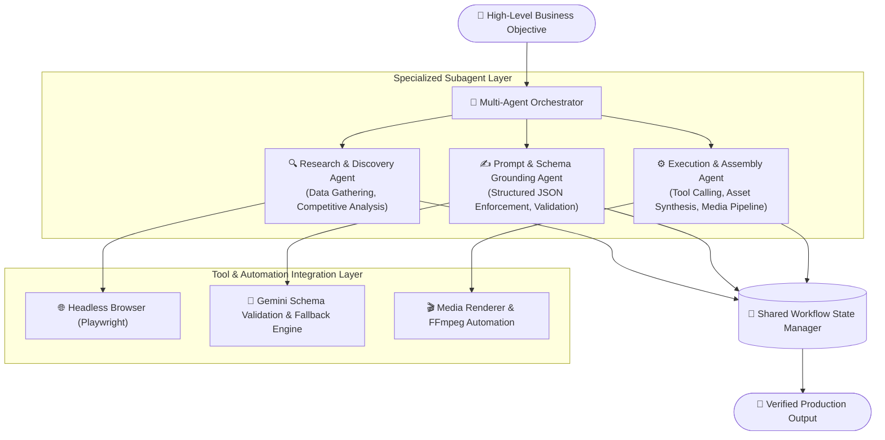

# Hexer — Autonomous Multi-Agent AI Workflow System

[](https://github.com/Pxrikshit)
[](https://python.org)
[](https://ai.google.dev)
[](https://playwright.dev)
[](#-proprietary--evaluation-license)

**Hexer** is an autonomous multi-agent Python system engineered to decompose high-level business goals into modular technical tasks, execute asynchronous research pipelines, enforce structured schema grounding, and coordinate automated end-to-end media production workflows.

---

## 🏗️ System Architecture

The core architecture decouples cognitive reasoning from execution by leveraging a hierarchy of specialized subagents orchestrated via an asynchronous event loop:



---

## ⚡ Key Capabilities

### 1. Agentic Goal Decomposition
* Deconstructs complex, ambiguous instructions into prioritized dependency graphs with clear preconditions and postconditions.
* Prevents context saturation by scoping each subagent's memory footprint to its specific operational phase.

### 2. Schema Grounding & Output Guarantee
* Enforces strict Pydantic and JSON schemas across all LLM inference calls, preventing hallucination and malformed outputs.
* Features automatic retry-with-sanitization triggers when unexpected response structures are detected.

### 3. Dynamic Tool Calling & Browser Automation
* Incorporates headless browser automation via **Playwright** to conduct live information retrieval and verify digital assets.
* Manages async I/O worker pools with token-bucket rate limiters to ensure continuous execution without API throttling.

### 4. Enterprise Resilience & Fault Tolerance
* Dynamic fallback logic automatically switches model tiers or activates localized cached results during upstream API disruptions.
* Comprehensive state logging captures step-by-step traces for full auditability and post-execution analytics.

---

## 🛠️ Repository Structure

```text
Hexer-MultiAgent-Workflow/
├── core/
│   ├── orchestrator.py        # Abstract multi-agent pipeline engine
│   ├── subagents.py           # Specialized subagent interfaces & dispatchers
│   └── schemas.py             # Pydantic schemas for tasks, states & tools
├── requirements.txt           # Environment dependencies
├── LICENSE                    # Proprietary evaluation license
└── README.md                  # System architecture and documentation
```

---

## 💻 Tech Stack

* **Core Engine:** Python 3.10+, Asynchronous I/O (`asyncio`)
* **LLM Orchestration:** Google Gemini API, Custom Multi-Agent Dispatchers
* **Data Validation:** Pydantic V2, JSON Schema Grounding
* **Tool Calling & Automation:** Playwright, Subprocess Sandboxing, FFmpeg
* **State Management:** In-memory async state machines, Redis caching interfaces

---

## 🔒 Proprietary & Evaluation License

> **Notice:** This repository contains architectural documentation, system interface specifications, and abstract orchestration code for the **Hexer Autonomous Multi-Agent AI System**.
> 
> **Copyright © 2025–2026 Parikshit Haldher. All Rights Reserved.**
> 
> This source code and documentation are published strictly for **technical portfolio evaluation and demonstration purposes**. No portion of this software may be copied, redistributed, reverse-engineered, or deployed for commercial purposes without prior written authorization from the copyright holder.

---

## 👤 Author

* **Parikshit Haldher**
* **LinkedIn:** [parikshithaldher](https://www.linkedin.com/in/parikshithaldher/)
* **GitHub:** [@Pxrikshit](https://github.com/Pxrikshit)
* **Email:** parikshithaldher71@gmail.com
